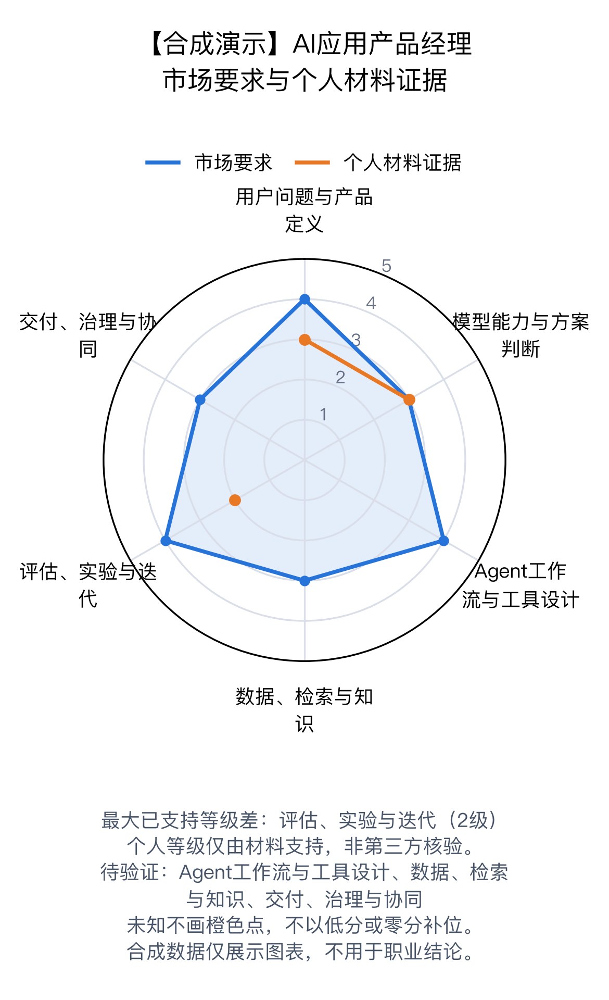

# AI应用产品经理｜市场认知与证据诊断

> 合成演示案例：能力画像、个人材料和结论均为虚构，不代表真实市场或个人。
> 范围：北京｜中级｜Agent产品｜截至 2026-10-10

## 1. 三个核心结论

- 合成演示：市场模型把Agent流程与效果评测作为重要能力。

- 合成演示：已有材料仅支持部分问题定义、模型方案比较和案例复盘。

- 合成演示：Agent流程、检索知识和跨职能交付仍待验证，不能据此判断为能力短板。

## 2. 原认知与市场证据

| 原认知 | 对照结果 | 说明 |
|---|---|---|
| AI产品经理主要价值是写好提示词。 | 部分支持 | 提示设计可能有用，但合成模型还包含问题定义、工作流、评估和交付。 |

样本覆盖：候选 1 条；纳入 1 条。市场判断：可评级（已复核）。复核理由：仅合成脚本演示数据，虚构样本不构成真实市场评级。

市场样本边界：完全合成的数据，仅用于验证格式、校验和图表行为。不能用于职业判断。

## 3. 完整市场能力树

### 用户问题与产品定义（市场期望：L4｜核心）

合成评分：示例要求能将用户问题转成可验证产品目标。　来源：SYNTH-1（合成虚构来源）

- L1：能复述需求，尚不能界定问题。
- L2：能描述目标用户和主要场景。
- L3：能用证据拆解问题并定义可验证目标。
- L4：能权衡用户、业务与模型边界，形成完整方案。
- L5：能持续重构产品方向并验证规模化价值。

实际任务：合成演示任务：用户问题与产品定义

### 模型能力与方案判断（市场期望：L3｜核心）

合成评分：示例要求能判断模型适用边界和方案取舍。　来源：SYNTH-1（合成虚构来源）

- L1：知道常见AI术语。
- L2：能说明模型能力和局限。
- L3：能基于任务选择模型或非模型方案。
- L4：能设计可靠的模型协作与降级策略。
- L5：能建立跨场景的技术产品决策框架。

实际任务：合成演示任务：模型能力与方案判断

### Agent工作流与工具设计（市场期望：L4｜核心）

合成评分：示例岗位涉及工具调用与流程编排。　来源：SYNTH-1（合成虚构来源）

- L1：能描述单轮问答流程。
- L2：能画出简单多步任务流程。
- L3：能定义工具边界、异常与人工接管。
- L4：能设计可观察、可评估的端到端Agent流程。
- L5：能推动复杂流程的平台化与规模化复用。

实际任务：合成演示任务：Agent工作流与工具设计

### 数据、检索与知识（市场期望：L3｜核心）

合成评分：示例需要基本的检索与知识产品判断。　来源：SYNTH-1（合成虚构来源）

- L1：知道产品依赖数据或知识。
- L2：能描述数据来源和更新需求。
- L3：能定义检索质量、知识治理和反馈指标。
- L4：能定位检索链路问题并设计持续改进。
- L5：能建立跨业务的知识与数据产品体系。

实际任务：合成演示任务：数据、检索与知识

### 评估、实验与迭代（市场期望：L4｜核心）

合成评分：示例强调评估和线上改进。　来源：SYNTH-1（合成虚构来源）

- L1：以主观体验判断效果。
- L2：能整理典型案例并比较结果。
- L3：能设计离线评测集和关键指标。
- L4：能结合线上反馈定位问题并验证改进。
- L5：能构建稳定评估机制并驱动持续迭代。

实际任务：合成演示任务：评估、实验与迭代

### 交付、治理与协同（市场期望：L3｜核心）

合成评分：示例需要跨职能推进并处理风险。　来源：SYNTH-1（合成虚构来源）

- L1：能跟进个人任务。
- L2：能与单一研发团队协作交付。
- L3：能跨职能拆解计划、风险和验收责任。
- L4：能解决复杂依赖并稳定规模化上线。
- L5：能建立组织级协作和治理机制。

实际任务：合成演示任务：交付、治理与协同

## 4. 个人证据与差距
能力差距须有低于目标的行为证据或明确的任务反证；证据差距表示材料不足；“待验证”表示当前不能判断。未提及不代表没做过或不知道。

| 能力 | 状态/差距类型 | 材料评分 | 证据与判断 | 下一步所需证据 |
|---|---|---:|---|---|
| 用户问题与产品定义 | 能力差距（材料支持） | L3 | 合成虚构证据支持部分独立定义目标。；虚构材料：完成一次用户问题拆解练习。（材料：MAT-1；用户自述） | 补充可回溯产出或结果以增强证据可信度 |
| 模型能力与方案判断 | 材料支持（达到或超过市场预期） | L3 | 合成虚构证据支持方案比较。；虚构材料：记录过模型与规则方案的比较。（材料：MAT-1；用户自述） | 补充可回溯产出或结果以增强证据可信度 |
| Agent工作流与工具设计 | 未知／待验证 | 未定级 | 尚无材料支持判断。 | 本人任务、决策和结果的具体材料 |
| 数据、检索与知识 | 未知／待验证 | 未定级 | 尚无材料支持判断。 | 本人任务、决策和结果的具体材料 |
| 评估、实验与迭代 | 能力差距（材料支持） | L2 | 合成虚构证据仅支持案例复盘。；虚构材料：对少量失败案例做过归类。（材料：MAT-1；用户自述） | 补充可回溯产出或结果以增强证据可信度 |
| 交付、治理与协同 | 未知／待验证 | 未定级 | 尚无材料支持判断。 | 本人任务、决策和结果的具体材料 |

## 5. 未来30天优先行动

### 1. 验证Agent工作流是否有可复盘的个人实践。
- 类型：补举证；关联能力：Agent工作流与工具设计（agent_workflow）
- 任务：用一个虚构业务任务画出工具边界、异常处理和人工接管流程。
- 产出：一页流程图和关键取舍说明。
- 核验：由同伴按rubric核对边界、异常和验收是否齐全。
- 周期：第1周

### 2. 把案例复盘提升为可核查的评估设计。
- 类型：补能力；关联能力：评估、实验与迭代（evaluation）；证据编号：EV03
- 任务：为虚构场景定义成功指标、测试样本和失败归因方法。
- 产出：评测计划与样例集。
- 核验：逐项对照rubric并记录未覆盖问题。
- 周期：第2–3周

### 待验证追问（逐轮询问，每轮一个主要问题）

- 请描述你本人参与过的一次多步AI任务：你定义了哪些工具边界或人工接管条件？想确认：Agent工作流能力是否有直接材料证据。

- 你曾如何定义一项AI功能的成功指标和评测样本？想确认：评测能力能否从案例复盘提升到独立设计。

- 在一次跨团队上线中，你负责的验收标准和风险处理是什么？想确认：协同交付证据。

## 来源登记

- **SYNTH-1｜合成示例｜虚构AI应用产品经理岗位**（示例地区，2026-09-01；采集 2026-10-10）：合成虚构来源，原始演示记录（不对应真实岗位页）。虚构岗位描述，仅为测试结构与引用关系。 纳入状态：纳入本次范围；来源状态：合成演示；来源限制：仅用于演示结构与呈现。
