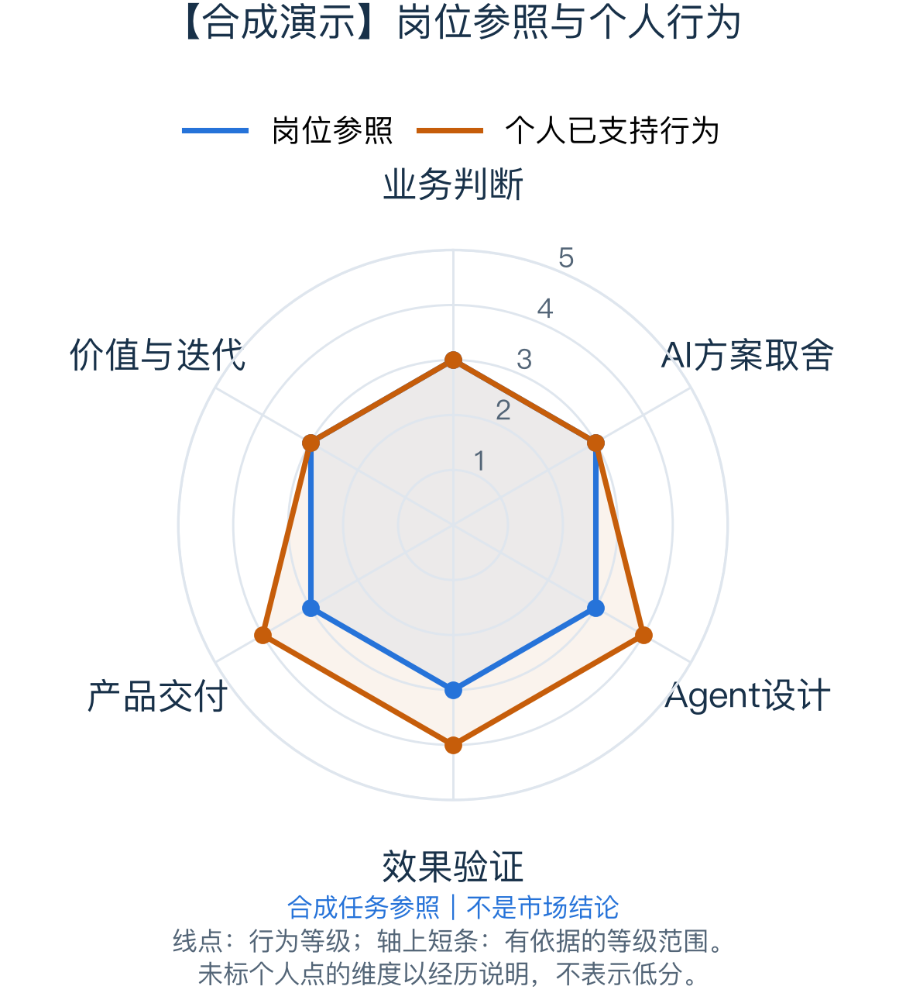

# Career Lens｜企业Agent应用产品经理

合成地区 · 中高级 · 2026-10-11 · **合成演示：非真实诊断**

## 1. 你的定位

**你已有小范围AI任务交付、评估和反馈闭环。用户数量小不否定这些经历，下一步应增强复杂任务举证。**

> 全部岗位、经历和等级均为虚构演示。L3代表独立常规任务，L4代表主导复杂任务，不是录用概率。

### 基础：闭环已经存在

5位用户连续使用4周，并有质量标准、坏例和改动复测。 [虚构企业A](https://example.invalid/synthetic-job)

### 阻碍：复杂责任还需完整呈现

案例可进一步展开跨系统依赖、异常和成本判断，便于审阅复杂责任。 [虚构企业A](https://example.invalid/synthetic-job)

### 投入：深化已有结果

先补复杂情境的过程说明，再决定是否扩大用户。 [虚构企业A](https://example.invalid/synthetic-job)

## 2. 最值得关注的差异

### 按实际责任解释下一步

- 岗位任务：虚构岗位独立负责任务定义、质量与真实使用。
- 你的经历：5位用户连续使用4周，并有质量标准、坏例和改动复测。
- 对你的影响：案例可进一步展开跨系统依赖、异常和成本判断，便于审阅复杂责任。

依据：[虚构企业A](https://example.invalid/synthetic-job)

## 3. 接下来先做这2件事

### 1. 整理已有复杂任务案例

- 任务：整理权限冲突、评分校准、灰度决策与复测。
- 产出：一份可回溯的脱敏任务案例及结果记录。
- 完成条件：本人责任清楚，选择有依据，结果和项目阶段准确。
- 顺序与周期：先整理；建议两周。

### 2. 选择下一项业务验证

- 任务：依据现有反馈选择新任务，保留成本与失败基线。
- 产出：一份可回溯的脱敏任务案例及结果记录。
- 完成条件：本人责任清楚，选择有依据，结果和项目阶段准确。
- 顺序与周期：先整理；建议两周。

[查看研究与判断依据](synthetic-v02-report-evidence.md) · [打开图文版](synthetic-v02-report.html)
